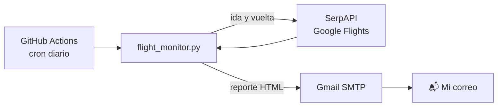

# ✈️ ScriptVuelos · Monitor de tiquetes BAQ ↔ BOG

Script en Python que revisaba cada día los precios de vuelos entre Barranquilla y Bogotá en Google Flights y enviaba un reporte en HTML por correo. Corría solo con GitHub Actions, sin servidor propio.

**Estado: terminado.** Cumplió su objetivo: compré los tiquetes y deshabilité el workflow.

## 💡 El problema

Revisar los precios a mano todos los días es tedioso y es fácil perder una baja de precio. Quería recibir la información en el correo, con los vuelos que estaban por debajo de mi presupuesto.

## ⚙️ Cómo funciona



1. El workflow se ejecuta a diario, o a mano desde la pestaña **Actions**.
2. El script consulta la ida y la vuelta, une los resultados, quita duplicados y ordena por precio.
3. Filtra los vuelos que cuestan igual o menos que `PRECIO_MAXIMO_COP`.
4. Envía **siempre** un correo con el estado del día:
   - Bloque verde: tabla con los vuelos bajo el umbral y enlace para reservar.
   - Bloque rojo: no hay vuelos bajo el umbral, muestra el precio más bajo encontrado.
   - El asunto cambia cuando hay al menos un vuelo bajo el umbral.

## 🧠 Lo que aprendí

- **Validar la fuente de datos antes de construir.** Empecé con la API de Aviasales, pero no devolvía resultados, así que cambié a SerpAPI, que consulta Google Flights.
- **Un cron de GitHub Actions no es exacto.** El workflow está programado a las 16:05 UTC, pero las últimas ejecuciones arrancaron entre las 17:38 y las 19:53 UTC. Sirve para un reporte diario, no para algo que dependa de la hora exacta.
- **Secretos fuera del código.** Las credenciales viven en GitHub Secrets y llegan al script como variables de entorno.

## 🛠️ Stack

Python 3.12 · `requests` · SerpAPI (Google Flights) · Gmail SMTP · GitHub Actions

## 🚀 Cómo correrlo

**Necesitas** una llave de [SerpAPI](https://serpapi.com) y una [contraseña de aplicación de Gmail](https://myaccount.google.com/apppasswords).

### En GitHub Actions

1. Haz un fork del repositorio.
2. En **Settings → Secrets and variables → Actions**, crea estos secrets:

   | Secret | Valor |
   |---|---|
   | `GMAIL_USER` | Correo que envía el reporte |
   | `GMAIL_PASSWORD` | Contraseña de aplicación de 16 caracteres |
   | `NOTIFY_EMAIL` | Correo que recibe el reporte |
   | `SERPAPI_KEY` | Llave de SerpAPI |

3. Ajusta las fechas en `flight_monitor.py`, porque las actuales ya pasaron.
4. En **Actions → Monitor Tiquetes BAQ BOG**, habilita el workflow y usa **Run workflow**.

### En tu computador

El script lee las variables del entorno. Usa `.env.example` como guía de cuáles necesita.

```bash
pip install -r requirements.txt
python flight_monitor.py
```

## 🔧 Personalización

En `flight_monitor.py`:

```python
ORIGIN_IDA        = "BAQ"
DESTINATION_IDA   = "BOG"
DATE_IDA          = "2026-07-23"
DATE_VUELTA       = "2026-07-26"
PRECIO_MAXIMO_COP = 200_000
```

El horario está en `.github/workflows/flight_monitor.yml`:

```yaml
- cron: "5 16 * * *"   # 16:05 UTC = 11:05 AM en Colombia
```

## 📄 Licencia

[MIT](LICENSE)
